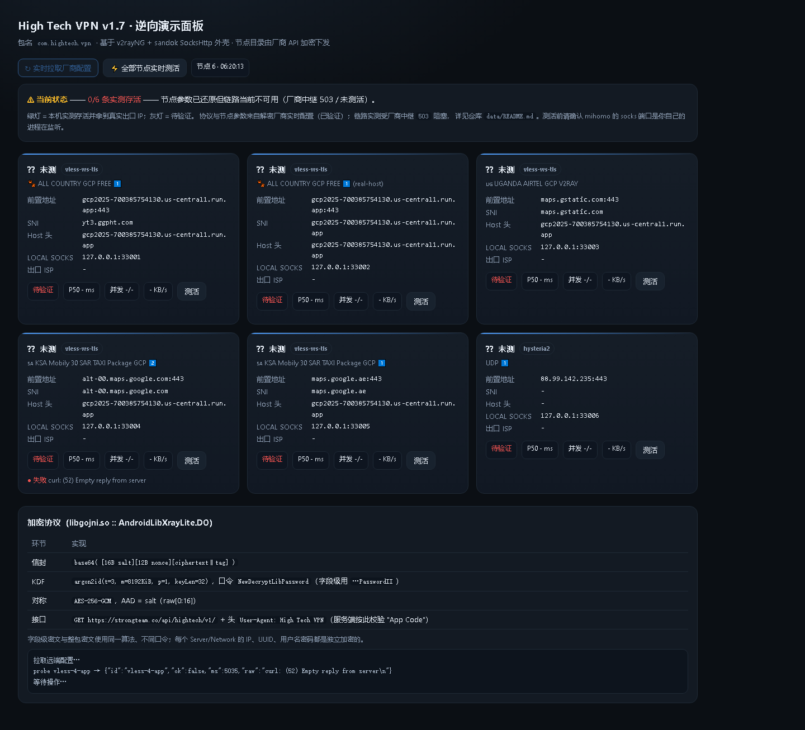

# High Tech VPN v1.7 — APK 逆向 · 加密配置下发协议还原

> Android VPN App `com.hightech.vpn`（v2rayNG + sandok SocksHttp 外壳）的配置下发协议完全还原：
> 厂商把节点目录用 **argon2id + AES-256-GCM** 加密后经 HTTP 下发，网关地址与解密逻辑都藏在
> `libgojni.so`（Go 1.24.3 的 `AndroidLibXrayLite` 定制分支）里。
> 本项目给出**可独立运行的解密器、节点生成器、测活/压测工具、演示面板与对接文档**。

<p>


</p>



## 状态

| 项 | 状态 | 证据 |
|---|---|---|
| 网关地址 / 请求伪装（UA 当作 App Code） | ✅ 已验证 | `docs/REVERSE_REPORT.md` §3.8–3.9；缺 UA → `404 Invalid App Code`，补 UA → `200` + 21908 B 密文 |
| 信封加密（双口令 / KDF / AAD=salt） | ✅ 已验证 | 自写实现解出真实响应：`Version 1.11`、5 Servers、9 Networks；`tools/ht_decrypt.py --selftest` 往返通过 |
| 节点构造规则（VLESS-WS-TLS / Hysteria2 / OpenVPN） | ✅ 已验证（静态+解密产物） | `docs/PROTOCOL.md` §5，`data/nodes.sample.json` |
| 链路可用性（真实出口 IP / 延迟 / 吞吐） | ⚠️ **待验证** | 厂商 Cloud Run 中继在本轮采样窗口内返回 `503/500`（`server: Google Frontend`），Hysteria2 UDP 静默；详见 `data/README.md` |
| OpenVPN 分支（25 条） | ❌ 已失效 | `boujeeteam.xyz` 与 `v2ray1..25.zamsytam.xyz` 全部 `NXDOMAIN`（DoH 双源确认） |
| new-api 对接方案 | 📄 文档就绪 | `docs/NEWAPI_INTEGRATION.md`（mihomo 多 socks listener → 代理清单） |

> 第一轮测活曾给出「12/12 存活、6 国出口」的数字，复核发现是**端口串线**（本机 v2rayN 的 xray 占着 3100x，
> 我们的 mihomo 没绑上，测到的其实是用户自己的节点），已整体作废并删除。教训写进了 `tools/probe.py` 的
> `assert_own_listeners()`：绑不上端口就立即失败退出。

## 协议三句话

```
GET https://strongteam.co/api/hightech/v1/    头: User-Agent: High Tech VPN
body = base64( [16B salt][12B nonce][ciphertext‖tag] )
plain = AES-256-GCM( argon2id("NewDecryptLibPassword", salt, t=3, m=8192KiB, p=1, 32B), nonce, AAD=salt )
```

字段级密文同一套算法，口令换成 `NewDecryptLibPasswordII`（23 字节）。

## 快速开始

```bash
pip install argon2-cffi cryptography        # 仅这两个依赖

# 0) 自检(不联网)
python tools/ht_decrypt.py --selftest

# 1) 拉配置 + 解密 + 出节点 (国内网络需要 --upstream)
python tools/refresh.py --out-dir out --base-port 33000 --upstream socks5h://127.0.0.1:10808

# 2) 起隧道 (mihomo, 每个节点一个 127.0.0.1:330xx socks 端口)
mihomo -f out/mihomo.yaml -d out

# 3) 测活 + 压测 + 导出代理清单
python tools/probe.py  --out-dir out --no-start
python tools/bench.py  --out-dir out --no-start
python tools/export_proxies.py --out-dir out      # → out/proxies.txt (socks5://…)

# 4) 演示面板
DEMO_STATE=out python demo/demo_server.py         # http://127.0.0.1:8933
```

> `--base-port` 一定选一个**本机没被占用**的段，并用 `probe.py` 的绑定检查确认 mihomo 真的绑上了。

## 目录

```
docs/PROTOCOL.md             ★ 实现手册：常量表 / 信封格式 / 配置 schema / 节点构造 / 坑清单
docs/REVERSE_REPORT.md       逆向全记录：APK 结构、动态路线为何失败、Go 函数定位与寄存器级算法还原
docs/NEWAPI_INTEGRATION.md   对接 new-api 代理池的三层验收方案与容器网络坑
tools/ht_decrypt.py          信封/字段解密器（含自检与实时拉取）
tools/refresh.py             拉取→解密→nodes.json / mihomo.yaml / ovpn
tools/probe.py               测活（含「端口被占就报错」的绑定检查）
tools/bench.py               压测：顺序延迟 + 并发成功率 + 下载吞吐
tools/export_proxies.py      导出 new-api 可用的 socks5 清单
demo/demo_server.py|html     演示面板（协议说明 + 节点卡片 + 实时测活/刷新）
data/                        脱敏节点样本 + 数据可信度说明
screenshots/                 面板截图
```

## 加密/协议要点（容易踩的坑）

1. **AAD 必须是 salt**（`raw[0:16]`），不传 / 传空 / 传 nonce 都只会得到 `InvalidTag`。
2. **两个口令只差 2 字节**：整包 21 字节 `NewDecryptLibPassword`，字段 23 字节 `…PasswordII`。
3. 缺 `User-Agent: High Tech VPN` 时服务端返回 **404 `Invalid App Code`**（不是 401，也没有任何 Key 可猜）。
4. `Networks[].V2rayServerNeed` 要和 `Servers[].ServerType` 配对；配置里出现 `CF Worker` 但没有对应服务器时该通道不可用。
5. Hysteria2 **只开 UDP**，TCP 探活必然超时，别误判成死节点。
6. 同一后端换一个 TLS SNI / 前置域名就是不同出口（服务端按前置域名分流），别在去重时把它们合并掉。

## 合规声明

- 本仓库只发布**协议与算法知识**与可复现工具，不附带 APK 内受版权资产（`assets/` 不在仓库内，`.gitignore` 排除）。
- 文档与样本中的凭证（VLESS UUID、Hysteria2 口令、OpenVPN 账号）**全部脱敏**；需要真实凭证请用你自己手上的 APK / 自行拉取。
- 节点属于运营方（`strongteam.co` / Telegram `t.me/htechvpn`）的**商业基础设施**：凭证可得 ≠ 授权使用。
  把其节点灌进自己的生产代理池属于无偿占用他人带宽与 IP 信誉，**不建议**作为主力池，仅适合作研究样本或稀缺地区临时兜底，
  风险由使用者自担。
- 请勿用于任何违法用途。

## Roadmap

- [ ] 厂商中继恢复后重跑 `probe/bench`，补上 6 个出口的真实延迟/吞吐（脚本与检查项已就绪）
- [ ] 覆盖 `Xhttp` / `Custom-1` / `CF Worker` 三种未下发的通道类型
- [ ] 逐条还原 `AndroidLibXrayLite.GV/GC/EO/PO/SO/isSecured`（设备指纹与完整性校验）
- [ ] 把「前置域名 → 出口国」的映射做成可轮换池，加双阈值摘除（连续 2 轮失败才剔除）
